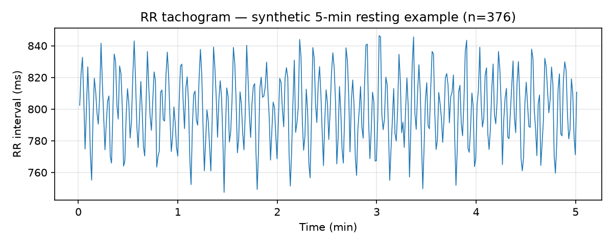
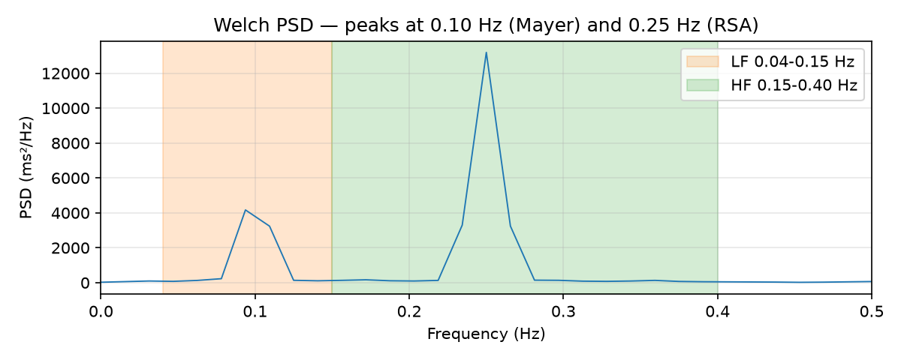

# hrv-analysis

Heart rate variability (HRV) analysis from RR intervals — time-domain
and frequency-domain metrics with the definitions of the Task Force
of the European Society of Cardiology and the North American Society
of Pacing and Electrophysiology (1996).

> **Not a medical device.** This is an educational/research tool. Its
> output is a rough orientation against published short-term norms, not
> a diagnosis. See [Limitations](#limitations).

## Background

Heart rate variability is the fluctuation in the time intervals
between consecutive heartbeats (interbeat intervals). A healthy heart
is not a metronome: beat-to-beat variation reflects autonomic
regulation — parasympathetic (vagal) activity acting fast (< 1 s),
sympathetic activity slower (> 5 s) — plus respiratory sinus
arrhythmia and the baroreflex (Shaffer & Ginsberg 2017).

This tool computes, from a series of RR intervals in milliseconds:

**Time domain** (Task Force 1996, Table 1):

| Metric | Meaning |
| --- | --- |
| Mean RR / Mean HR | Average interval and heart rate (60000 / mean RR) |
| SDNN | Standard deviation of all NN intervals — overall HRV |
| RMSSD | Root mean square of successive differences — short-term, vagally mediated HRV |
| SDSD | Standard deviation of successive differences |
| NN50 / pNN50 | Count / percentage of successive differences > 50 ms |
| CV | SDNN / mean RR — variability relative to heart rate |

**Frequency domain** (Welch PSD of the cubic-interpolated RR series
at 4 Hz; bands per Task Force 1996): VLF 0.0033–0.04 Hz, LF 0.04–0.15
Hz, HF 0.15–0.40 Hz, total power, LF/HF ratio, LF/HF in normal units
(nu), and LF/HF peak frequencies.

Full research notes, formulas, conventions and sources:
[`docs/RESEARCH.md`](docs/RESEARCH.md).

## Project structure

```
hrv-analysis/
├── analyze.py                  # thin wrapper: python analyze.py file.csv
├── requirements.txt
├── LICENSE                     # MIT
├── README.md
├── src/hrv_analysis/
│   ├── __init__.py
│   ├── __main__.py             # python -m hrv_analysis
│   ├── cli.py                  # argument parsing + report assembly
│   ├── metrics.py              # time-domain metrics (Task Force defs)
│   ├── frequency.py            # Welch PSD, LF/HF bands
│   ├── interpret.py            # rough orientation vs published norms
│   └── io.py                   # CSV/TXT RR file loading
├── tests/
│   └── test_hrv.py             # hand-computed values + band tests
├── examples/
│   ├── sample_rr.csv           # synthetic 5-min RR series (n=376)
│   ├── nsr16265_rr.csv         # real NN intervals, MIT-BIH NSRDB record 16265
│   ├── generate_sample.py      # regenerates sample_rr.csv (seed 42)
│   ├── plot_examples.py        # regenerates tachogram.png / psd.png
│   ├── tachogram.png
│   ├── psd.png
│   ├── example_output.txt      # real CLI output on sample_rr.csv
│   └── nsr16265_output.txt     # real CLI output on nsr16265_rr.csv
└── docs/
    └── RESEARCH.md
```

## Installation

```bash
pip install -r requirements.txt   # numpy, scipy, matplotlib, pytest
```

Python ≥ 3.10. `scipy` is only needed for frequency-domain analysis;
time-domain metrics and the tests for them run on `numpy` alone.

## Usage

Input: a CSV or TXT file with one RR interval in milliseconds per
line. A header row, blank lines and `#` comments are ignored.

```bash
# Time + frequency domain (default)
python analyze.py examples/sample_rr.csv

# Or as a module
PYTHONPATH=src python -m hrv_analysis examples/nsr16265_rr.csv

# Time domain only
python analyze.py examples/nsr16265_rr.csv --no-frequency

# Also write the report to a file
python analyze.py examples/sample_rr.csv -o report.txt
```

## Example output

Real output of `python analyze.py examples/sample_rr.csv`
(synthetic 5-min resting series, n = 376) — full text in
[`examples/example_output.txt`](examples/example_output.txt):

```
Time-domain HRV metrics
----------------------------------
Intervals (N)      376
Mean RR            799.59 ms
Mean HR            75.04 bpm
SDNN               21.97 ms
RMSSD              23.72 ms
SDSD               23.72 ms
NN50               3
pNN50              0.80 %
CV (SDNN/mean RR)  2.75 %
RR range           747.4 - 846.4 ms

Frequency-domain HRV metrics (Welch PSD, 4 Hz cubic interp.)
----------------------------------------------------------
Duration                    300.6 s
VLF power (0.0033-0.04 Hz)  1.2 ms^2
LF power (0.04-0.15 Hz)     124.8 ms^2
HF power (0.15-0.40 Hz)     329.1 ms^2
Total power                 455.1 ms^2
LF/HF ratio                 0.38
LF (nu)                     27.5
HF (nu)                     72.5
LF peak                     0.094 Hz
HF peak                     0.250 Hz
```

The two PSD peaks recover exactly the frequencies built into the
synthetic series (Mayer wave 0.10 Hz, RSA 0.25 Hz) — a built-in
sanity check of the frequency pipeline.

Real data — first 5 min of MIT-BIH Normal Sinus Rhythm record 16265
(n = 480 NN intervals), full text in
[`examples/nsr16265_output.txt`](examples/nsr16265_output.txt):

```
Mean RR  622.55 ms   Mean HR  96.38 bpm
SDNN     31.87 ms    RMSSD    17.20 ms
SDSD     17.20 ms    pNN50    1.46 %
LF power 518.9 ms^2  HF power 113.6 ms^2  LF/HF 4.57
```





## Interpretation

The CLI compares SDNN, RMSSD and LF/HF against the short-term
(~5 min) healthy norms meta-analysed by Nunan et al. (2010) and
tabulated by Shaffer & Ginsberg (2017, Table 6): SDNN 50 ± 16 ms
(range 32–93), RMSSD 42 ± 15 ms (19–75), LF/HF 2.8 ± 2.6 (1.1–11.6).
It labels each value only as below / within / above that published
range. Norms depend on recording length, age, sex, posture,
breathing and fitness, and short-term values are not interchangeable
with 24 h values — the CLI prints this caveat every time.

## Tests

```bash
python -m pytest tests/ -q
# 9 passed
```

The tests include hand-computed values for RR = [800, 850, 790, 820,
780] ms (RMSSD = √2150 ≈ 46.37 ms, SDNN = √616 ≈ 24.82 ms,
SDSD = √2125 ≈ 46.10 ms, NN50 = 1, pNN50 = 25%), a strict `> 50 ms`
threshold check for NN50, input validation, and two frequency-band
tests (a pure 0.10 Hz oscillation lands in LF, a pure 0.25 Hz one in
HF). The full hand calculation is written in the test file's docstring.

## Design decisions

- **Population SD for SDNN/SDSD** (`ddof=0`): the usual HRV-toolbox
  convention; documented in `metrics.py` because the Task Force
  text does not state the denominator.
- **pNN50 denominator is N−1** (number of successive differences),
  as in most implementations; the Task Force wording is ambiguous
  between N and N−1.
- **Input is assumed to be cleaned NN intervals.** The tool validates
  plausibility (300–2000 ms, finite, positive) and refuses garbage,
  but it does not do artifact correction — ectopic beats or missed
  detections must be removed upstream (as was done for the NSRDB
  example: only N–N intervals kept).
- **Frequency analysis via Welch on a 4 Hz cubic interpolation** —
  the standard pipeline; refused for recordings under 60 s, and
  flagged as less reliable under 5 min.
- **Interpretation is deliberately coarse** (range check + caveat),
  because published norms vary widely by context; the tool never
  prints a diagnosis.
- **No pandas, no heavy dependencies**: `numpy` + `scipy` only (plus
  `matplotlib` for the example plots).

## Limitations

- No artifact/ectopic-beat correction; dirty input gives wrong
  metrics (garbage in, garbage out).
- SDANN, SDNN index and the HRV triangular index (24 h measures)
  are not implemented.
- No non-linear metrics (Poincaré SD1/SD2, entropy, DFA) — listed
  as future work.
- VLF power from a 5-min recording is reported for completeness
  only; it is not interpretable at that length.
- LF/HF is not a clean index of sympathovagal balance (Shaffer &
  Ginsberg 2017); the tool says so in its output.
- The NSRDB example is one healthy subject's 5-minute segment, not
  a normative sample.

## References

1. Task Force of the European Society of Cardiology and the North
   American Society of Pacing and Electrophysiology (1996). Heart rate
   variability: standards of measurement, physiological interpretation
   and clinical use. *Eur Heart J* 17:354–381; *Circulation*
   93:1043–1065.
2. Shaffer, F. & Ginsberg, J. P. (2017). An overview of heart rate
   variability metrics and norms. *Front Public Health* 5:258.
   doi:10.3389/fpubh.2017.00258 —
   https://pmc.ncbi.nlm.nih.gov/articles/PMC5624990/
3. Nunan, D. et al. (2010). A quantitative systematic review of
   normal values for short-term heart rate variability in healthy
   adults. *Pacing Clin Electrophysiol* 33(11):1407–1417.
4. Goldberger, A. L. et al. (2000). PhysioBank, PhysioToolkit, and
   PhysioNet. *Circulation* 101(23):e215–e220. MIT-BIH Normal Sinus
   Rhythm Database: https://physionet.org/content/nsrdb/1.0.0/

## License

MIT — see [LICENSE](LICENSE).
